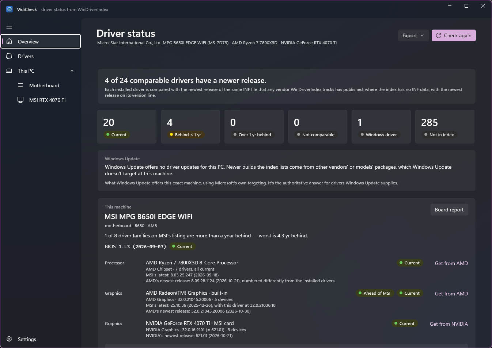
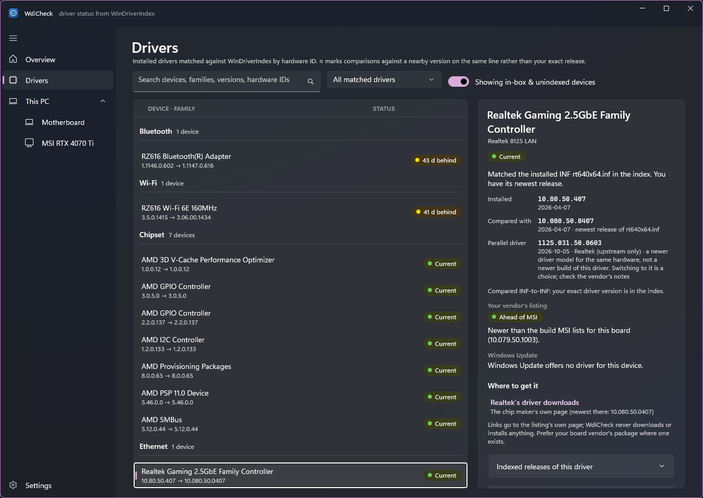
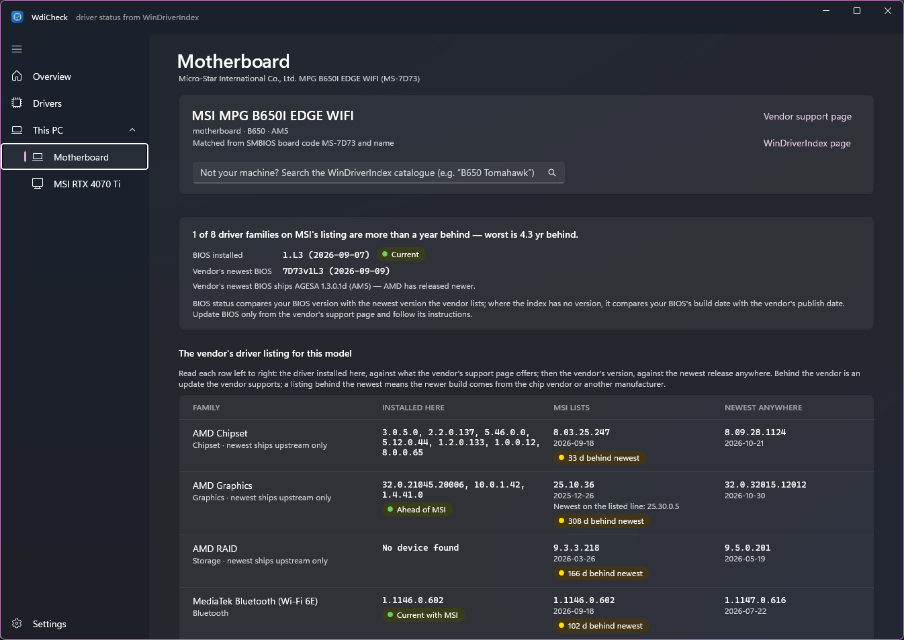

# WdiCheck

A Windows desktop app (WinUI 3) that checks the drivers installed on this PC against
[WinDriverIndex](https://windriverindex.tucny.com/) and shows which ones have a newer release.

It reads the hardware IDs and driver versions Windows reports for every present device,
matches them against the index's driver families, and compares each installed version with the
newest release anywhere: across MSI, Gigabyte, ASRock, ASUS, Lenovo, Dell, HP, Windows Update
and the silicon vendors. It also identifies the machine from SMBIOS and shows the vendor's own
support listing for it, including BIOS currency.

WdiCheck only reads. It never downloads or installs drivers; links go to the listing's own page.



## What you see

- **Overview** – counts by status, the identified machine with its BIOS status, and the drivers
  that need attention (sorted by how far behind they are). You can export CSV or JSON.
- **Drivers** – every matched device, grouped by component, with installed version, the newest
  comparable release and a status. The detail pane explains the match: which hardware ID hit,
  which families share it and why one was chosen, the releases on the same version line, and
  download links (your board vendor's first).
- **This PC** – a page for the motherboard or laptop, and one for each add-in graphics card.
  - **Board page:** the vendor's listing for your model (the site's `by-board` report), BIOS
    installed vs newest listed, and AGESA status on AMD boards. Each row reads left to right: your
    driver against the vendor's ("Current with MSI", "234 d behind MSI"), then the vendor's against the
    newest anywhere ("299 d behind newest"). So you can tell an update your vendor supports from a
    newer build that only exists elsewhere.
  - **Card pages:** the card maker's listing and VBIOS. Makers like MSI that link to NVIDIA's driver
    get NVIDIA's newest release instead.
  - **Choosing a model:** if matching is wrong or ambiguous, search the catalogue and pick your model
    (remembered). A card's PCI IDs are shared by a maker's models on one GPU, so the page asks for the
    model only when it matters: when one of them lists a VBIOS.
- **Settings** – theme, data source (any mirror of `/v1/latest/`), offline cache, attribution.

### Screenshots

**Drivers**: each device with its installed and newest version. The detail pane shows how the
driver was matched (here, the installed `rt640x64.inf`), the release it's compared with, a note
about the parallel NetAdapter line, and where to get the update.



**This PC › Motherboard**: the machine identified from its SMBIOS board code, BIOS currency, and the
vendor's driver listing next to what's installed.



### Statuses

| Status | Meaning |
|---|---|
| Current | At or above the newest indexed release of the same driver. *Newer than index* if above anything listed. |
| Behind (≤ 1 yr / > 1 yr) | A newer release exists. Lag = days between your driver's date and the newer release's. |
| ≈ | Package-level fallback only: your exact version isn't in the index, so it was compared with the nearest listed versions on the same line. Treat as a hint. |
| Not comparable | The device matched a family, but nothing the index lists can be compared with its version. |
| Windows driver | The device uses a Windows in-box driver; a vendor driver family exists for the hardware. |
| Not in index | No hardware ID of the device is in the index (most Microsoft/virtual/peripheral devices). |

### How matching works

**INF level (preferred).** Windows reports each device's INF `DriverVer`, and the index
publishes every INF release it has seen (`infs.json`, data schema 2.0.0). WdiCheck resolves
the installed `oemNN.inf` to the vendor's original INF name (for example `rt640x64.inf`)
through SetupAPI, and compares your DriverVer with the newest release of that INF. Some
vendors give every release a new INF name (AMD display drivers `u04xxxxx.inf`). For those,
releases of other INFs that bind the device's hardware ID are included too, restricted to
the same version line and device class. This is a like-for-like comparison, with no heuristics.

**Package level (fallback)**, used when an INF isn't in the index, or the data source predates schema 2.0.0:

1. Hardware IDs, then compatible IDs, most specific first. Class-level IDs (`PCI\CC_*`,
   `USB\Class_*`) are ignored, because they pair in-box drivers with unrelated vendor families.
2. The first ID found in `families.json` gives the candidate families. When several share it,
   the family that lists your exact version wins, then one that lists your version line, then one
   with a water level, then a silicon-vendor match.
3. Versions are compared within a **version line** (leading number + number of parts), because
   vendors publish the same driver in incompatible schemes (package vs INF versions, NDIS 10.x vs
   NetAdapter 1125.x). Two-part marketing versions (NVIDIA `616.92`) form a single line. The family
   newest also counts when it is on the directly following line, unless the index marks your line
   `parallel_to_water`.
4. Version-scheme translations (NVIDIA INF → marketing version, Realtek UAD builds) come from the
   index's `version_equiv` rules.
5. A numerically higher version released no later than yours is treated as a sibling component or
   branch, not an update.

Either way, when the family's newest release is on a genuinely parallel line that this device
could run (Realtek NDIS 10.x vs NetAdapter 1125.x), the detail pane notes it. It doesn't count
as an update, because parallel lines can target different Windows versions or driver models.

**Windows Update.** After each check, WdiCheck also asks Windows Update which drivers it offers
this exact machine, as Settings › Windows Update › Optional updates would. WinDriverIndex answers
"what's the newest build anywhere"; Windows Update answers "what will Microsoft give this PC", using
its own targeting. When the index finds a newer build but Windows Update offers nothing, the newer
build has to come from a vendor's page. The search takes 10–60 seconds in the background, needs no
elevation, installs nothing, and can be turned off in Settings.

**Machine identification** uses the index's SMBIOS keys (Dell SKU, HP platform ID, Lenovo MTM,
MSI board code), and falls back to matching names (Gigabyte, ASUS, ASRock).

## Data

All data comes from the WinDriverIndex static API (`https://windriverindex.tucny.com/v1/latest/`):
`manifest.json`, `families.json`, `water-level.json`, `artefacts.json`, `boards.json`,
`infs.json` and `by-board/{id}.json`. Written against data schema 2.0.0; 1.x mirrors still work
with package-level matching only. Files are cached in `%LOCALAPPDATA%\WdiCheck\cache`. On
refresh, the manifest's SHA-256 hashes show which cached files are still current, so an unchanged
index costs one small request, and the app still works offline from the last copy.

Index data is © WinDriverIndex contributors, licensed [CC-BY-4.0](https://creativecommons.org/licenses/by/4.0/).
"Newest" means the newest version any source has published, not a judgement that it is good.

Gaps in the data that WdiCheck works around are tracked as
[WinDriverIndex issues](https://github.com/dtucny/WinDriverIndex/issues).

## Building

Requirements: Windows 10 1809+ (Windows 11 recommended) and the .NET 10 SDK
(`winget install Microsoft.DotNet.SDK.10`). Visual Studio is not required.

```powershell
dotnet test --project tests/WdiCheck.Core.Tests  # unit tests
dotnet build WdiCheck.slnx                       # x64 debug build
src\WdiCheck.App\bin\x64\Debug\net10.0-windows10.0.19041.0\win-x64\WdiCheck.exe

./scripts/build.ps1                            # tests + unpackaged zip + unsigned MSIX → artifacts/
./scripts/build.ps1 -Platform ARM64 -Unpackaged
```

Artifact names carry the version from `Directory.Build.props`, for example
`artifacts/WdiCheck-0.2.8-win-x64.zip` and `artifacts/WdiCheck-0.2.8-win-x64-unsigned.msix`
(the `-unsigned` suffix is dropped when a certificate is given).

Release builds are trimmed and include only the WinUI part of the Windows App SDK, so each
package is about 32 MB (82 MB unpacked).

**Unpackaged** (`artifacts/WdiCheck-<version>-win-x64/`, plus a zip) is self-contained: .NET and the
Windows App SDK are bundled, so it runs by double-clicking `WdiCheck.exe`, with nothing to install.

**MSIX**: Windows only installs signed packages whose signer it trusts. For local testing:

```powershell
./scripts/new-dev-cert.ps1 -Trust          # elevated; creates CN=WdiCheck Dev and trusts it
./scripts/build.ps1 -Msix -CertificateThumbprint <thumbprint printed above>
Add-AppxPackage artifacts\WdiCheck-0.2.8-win-x64.msix
./scripts/new-dev-cert.ps1 -Untrust        # when done
```

The warning `Path to mspdbcmf.exe could not be found` on MSIX builds is expected without Visual
Studio; it only means no symbols package is produced.

`scripts/generate-assets.ps1` regenerates the icon and logo PNGs.

## Releasing

Pushing a version tag makes GitHub Actions build and publish a release
([.github/workflows/release.yml](.github/workflows/release.yml)):

1. Set `<Version>` in `Directory.Build.props` and the `Identity` `Version` in
   `src/WdiCheck.App/Package.appxmanifest` (same version, plus `.0`).
2. In `CHANGELOG.md`, move the Unreleased notes under `## [x.y.z] - yyyy-mm-dd` and add its compare link.
   Run `./scripts/dependency-changes.ps1` and add the lines it prints under `### Dependencies`: shipped
   dependency updates since the last tag (the .NET SDK, which sets the bundled runtime, and the
   app's NuGet packages), whether they came from Dependabot, the outdated-packages issue or a
   manual edit.
3. Commit, then tag and push:

   ```powershell
   git tag -a v0.2.8 -m "WdiCheck 0.2.8"
   git push origin main v0.2.8
   ```

The workflow checks that the tag matches both version numbers, and that the CHANGELOG section
mentions every shipped dependency change. It then runs the tests,
builds the x64 and ARM64 zips and MSIX packages with `scripts/build.ps1`, and creates the
GitHub release with that version's `CHANGELOG.md` section as its notes
(`scripts/release-notes.ps1 -Version x.y.z` previews them). To rebuild an existing release,
run the workflow manually from the Actions tab with the tag. Tags with a suffix
(`v0.3.0-beta.1`) are published as pre-releases.

Release packages are currently **unsigned**. Windows SmartScreen may warn about the zip's exe,
and the MSIX installs only where its signer is trusted.

## Layout

```
src/WdiCheck.Core/         API client + cache, version parsing, family & INF indexes, device & board matching, export
src/WdiCheck.App/          WinUI 3 app (MVVM, CommunityToolkit.Mvvm)
tests/WdiCheck.Core.Tests/ xUnit tests (fixtures built from real index rows)
scripts/                   build, release notes, outdated packages, dev certificate, asset generation
.github/workflows/         CI build and tests on PRs and main; release build on version tags
.github/dependabot.yml     weekly .NET SDK and Actions updates (NuGet: see outdated-packages.yml)
CHANGELOG.md               release notes
```

## Contributing and licence

Issues and pull requests are welcome; see [CONTRIBUTING.md](CONTRIBUTING.md).

Copyright (C) 2026 D. Tucny. WdiCheck is free software under the
[GNU GPL version 3 or later](LICENSE), with additional terms in [NOTICE](NOTICE): keep the
"Based on WdiCheck by D. Tucny" attribution, and mark modified versions as such rather than
presenting them as the original. The WinDriverIndex data it reads is licensed separately under
[CC-BY-4.0](https://creativecommons.org/licenses/by/4.0/).
